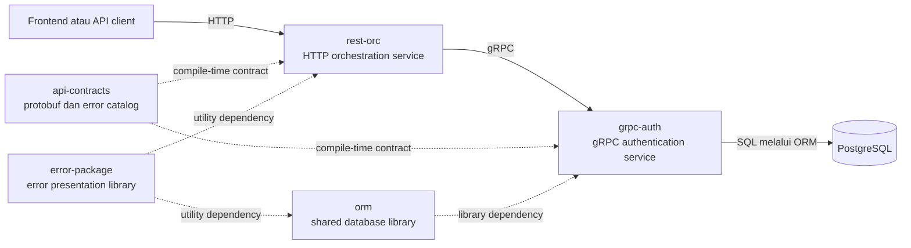

# System Map

Dokumen ini menjelaskan current-state Practice Architecture System. Rencana masa
depan harus diberi label sebagai proposal sampai disepakati dan diimplementasikan.

## Tujuan Sistem

Sistem menyediakan HTTP API untuk client, mengorkestrasikan request ke service
backend, mengelola autentikasi dan data user melalui gRPC, serta menggunakan
shared contracts dan shared database library agar boundary antar-komponen tetap
konsisten.

## Topologi Runtime dan Dependency

Garis penuh menunjukkan komunikasi runtime. Garis putus-putus menunjukkan
dependency source/module yang dikompilasi ke consumer.

## Komponen dan Tanggung Jawab Utama

### `rest-orc`

- Menjadi HTTP boundary untuk client.
- Menangani transport mapping, authentication/authorization middleware,
  orchestration, dan HTTP response/error mapping.
- Memanggil downstream melalui reusable gRPC atau HTTP clients.
- Tidak memiliki database dan tidak menyimpan JWT secara lokal.

### `grpc-auth`

- Mengimplementasikan authentication dan user/profile gRPC services.
- Memiliki business rule registrasi, login, `Me`, profile, role, dan list user.
- Memiliki user-related persistence dan transaction boundary.
- Menerbitkan serta memvalidasi JWT sesuai boundary yang berlaku.

### `api-contracts`

- Go module: `github.com/siti-nabila/api-contracts`.
- Memiliki protobuf source, generated Go contracts, paginator messages, serta
  shared error keys, codes, localized messages, dan mapping metadata yang
  dibutuhkan agar bentuk error antar-service konsisten.
- Menyediakan contract yang dapat dipetakan pada gRPC service maupun HTTP
  boundary tanpa membuat masing-masing consumer mendefinisikan ulang semantics.
- Tidak memiliki runtime business implementation.

### `orm`

- Menyediakan query, database adapter, transaction, pagination, dialect, dan
  supporting database behavior yang reusable.
- Tidak memiliki authentication atau user business rule.

### `error-package`

- Menyediakan mekanisme reusable untuk memuat definisi error, membentuk typed
  error/field errors, memilih localized message, dan menampilkan representasi
  error kepada service atau package consumer.
- Menggunakan definisi yang diberikan catalog/consumer; tidak memiliki business
  error key, code, atau message milik service tertentu.
- Tidak menentukan protobuf schema maupun HTTP/gRPC status mapping.

## Alur Utama

### Register dan Login

1. Client mengirim HTTP request ke `rest-orc`.
2. `rest-orc` memetakan HTTP request ke shared gRPC contract.
3. `rest-orc` memanggil `grpc-auth`.
4. `grpc-auth` menjalankan validation dan business flow.
5. `grpc-auth` menggunakan `orm` untuk persistence bila flow membutuhkan data.
6. Hasil atau structured error dikembalikan melalui gRPC.
7. `rest-orc` memetakan hasil ke HTTP response.

### Authenticated Request

1. Client mengirim bearer token ke `rest-orc`.
2. Authentication boundary `rest-orc` menggunakan auth service untuk memperoleh
   principal ketika flow memerlukannya.
3. Authorization dilakukan sebelum protected handler dijalankan.
4. Request context diteruskan sepanjang handler, use case, adapter, dan client.

## Source of Truth

| Concern | Owner |
|---|---|
| HTTP routes dan response boundary | `rest-orc` |
| Authentication dan user business behavior | `grpc-auth` |
| User/profile persistence | `grpc-auth` |
| Protobuf dan field semantics | `api-contracts` |
| Shared error key, code, message, dan mapping contract | `api-contracts` |
| Runtime error loading, localization, dan presentation mechanics | `error-package` |
| Generic database/query behavior | `orm` |
| System topology dan component ownership | `practice-archi-system` |

## System-Wide Invariants

- Perubahan contract dimulai di repository pemilik contract.
- Generated protobuf tidak diedit manual.
- Protobuf field number yang telah digunakan tidak boleh digunakan kembali.
- `rest-orc` tidak mengambil alih persistence atau JWT ownership.
- `grpc-auth` tidak mengambil alih public HTTP orchestration.
- Feature-specific business rule tidak dipindahkan ke `orm` atau shared utility.
- Business error key/code/message tidak didefinisikan ulang di `error-package`.
- Protocol mapping tidak dipindahkan dari contract/transport boundary ke
  `error-package`.
- Request context harus dipertahankan melintasi boundary request.
- Error internal, credential, token, dan database detail tidak boleh bocor ke
  public response atau log.
- Perubahan lintas repository harus menjaga backward compatibility kecuali
  breaking change disetujui secara eksplisit.

## Local Workspace

Parent `go.work` saat ini menghubungkan `grpc-auth`, `api-contracts`, dan
`rest-orc`. Workspace lokal memudahkan integration test sebelum module baru
dipublikasikan, tetapi consumer juga perlu diverifikasi dengan module version
yang dideklarasikan ketika perubahan contract akan dirilis.

## Keputusan Terbuka

1. `api-contracts/pkg/dictionary` saat ini masih memiliki sebagian registry,
   loading, dan runtime error types. Boundary ownership sudah ditetapkan, tetapi
   compatibility/migration plan menuju pemisahan tersebut belum diimplementasikan.
2. Mekanisme instalasi source system skill ke Codex belum ditentukan.
